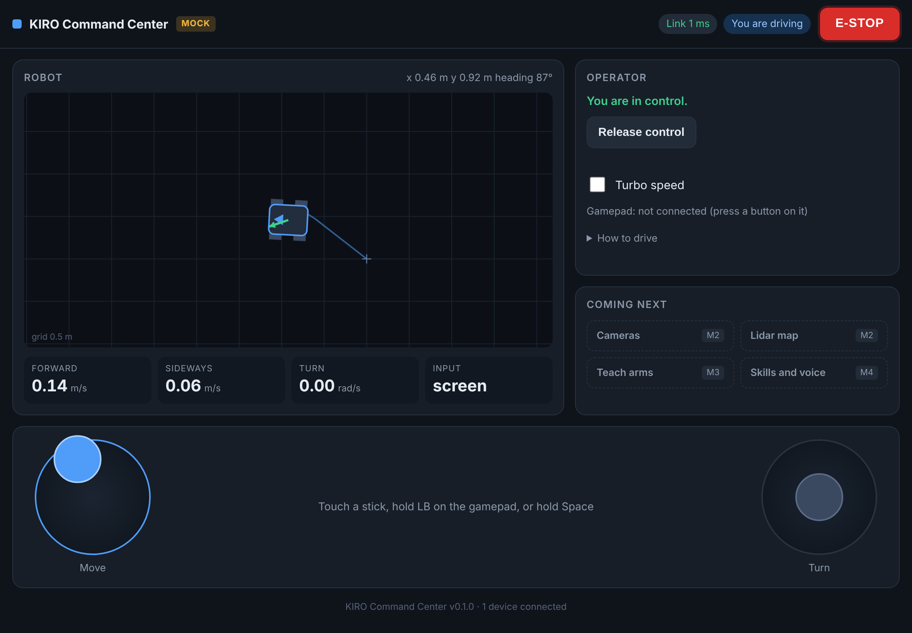

# KIRO Command Center

One web page that controls the whole KIRO robot (SO-101 dual-arm mobile robot on a mecanum base, Jetson Orin Nano).

The Jetson on the robot runs everything and creates its own Wi-Fi network. One operator opens the page on a laptop or phone and drives. **No internet, no router, nothing to install on the laptop.**



## Status

**Version 0.3 (18 Nov 2026).** Runs on the Jetson. Checked on the robot: page over the network, live camera, robot mode connected to ROS 2, read-only servo check. **Wheels and arms have not been moved from the page yet** (12 V and 5 V power were off).

| Part | State |
|---|---|
| Driving: on-screen sticks, gamepad, keyboard, one operator with PIN, E-STOP, heartbeat stop | Works. 24 automatic tests |
| Swiss-style page, English / Korean switch, phone layout | Works |
| Live camera (Gemini 335 `top`, wrist webcams when plugged in) | Works on the robot |
| Base start / stop (old launcher with lidar guard) | Wired, needs 12 V wheel power to test |
| Arms: fold, hold, release, teleop right / left / both | Wired to the old scripts. Left arm blocked until recalibrated |
| Run a skill (`right_arm_task2_act`) | Wired to `run_policy.sh`. Needs the `right_wrist` webcam |
| Voice: hold-to-talk (button, V key, gamepad Y), Korean and English (follows the page language) | Wired to the old `voice_cmd`. English needs the Vosk model `vosk-model-small-en-us-0.15` in `~/models/vosk` |
| Lidar points on the map (`/scan`, same mounting angle as the obstacle guard) | Works with the simulated room in mock mode. Lidar not plugged in yet |
| Dashboard page `/dashboard.html`: camera, lidar, speed, distance, nearest object, Jetson, servos, programs, activity | Works. Read-only, for a big screen |
| Health: Jetson, servo voltage / temperature / current, cameras. Shutdown / restart | Works (shutdown needs `deploy/kiro-shutdown.sudoers`) |
| Laptop remote arm control, recording, servo tester, calibration | Not in the page yet. Use the old app |

Plan and checklist: [to-do until 20 Nov](docs/KIRO_Todo_until_20_Nov.docx) · [full project plan](docs/KIRO_Command_Center_Project_Plan.docx)

## Try it on your laptop (2 minutes, no robot)

You need Python 3.10 or newer.

```bash
git clone https://github.com/incom8134-web/kiro-webapp.git
```

```bash
cd kiro-webapp && ./run.sh
```

Open **http://localhost:8080**, type the PIN **0000**, press **Take control**, and drive the pretend robot.

On Windows, use these three commands instead of `./run.sh`:

```bash
python -m venv .venv
```

```bash
.venv\Scripts\pip install -r requirements.txt
```

```bash
.venv\Scripts\python -m robot_server
```

## Controls

| Action | Gamepad | Keyboard | Screen |
|---|---|---|---|
| **Enable** (must be held) | hold LB | hold Space | touch a stick |
| Move | left stick | W A S D | left stick |
| Turn | right stick | Q / E | right stick |
| Turbo | RB | Shift | Turbo switch |
| Talk (voice on) | hold Y | hold V | Hold to talk button |
| **E-STOP** | Back / Select | Esc | red button |

If two inputs are used at once, the gamepad wins, then the on-screen sticks, then the keyboard.

## Safety rules built in

| Rule | What happens |
|---|---|
| Dead-man | The robot moves only while LB, a stick or Space is held |
| Lost connection | No message from the operator for 0.5 s: the robot stops |
| E-STOP | Anyone connected can press it. Only the operator can release it |
| After E-STOP or taking control | The controls must be let go once before the robot moves again |
| One operator | Other devices can only watch. Taking over needs the PIN |
| Speed | 0.15 m/s normal, 0.30 m/s turbo. Speed rises smoothly and drops at once |
| Lidar guard | Web commands go to `/cmd_vel_raw`, through the old obstacle guard, like the robot gamepad and voice |
| E-STOP also stops | Running skill and voice. Teleop keeps running: a person holds the leader arm |
| Devices | Two programs never open the same arm port or camera. The servo check skips busy ports |
| Dangerous buttons | Release torque, shut down and restart must be held for 2 s |
| Left arm | Blocked until recalibrated (`KIRO_LEFT_ARM_OK=1`) |

Software is not enough for public demos. The robot also needs a **physical switch that cuts servo power**.

## How it works


- `robot_server/` is a small Python server (FastAPI). It serves the page, keeps the operator lock and decides 20 times per second which speed is safe to send.
- On the robot it publishes `/cmd_vel_web`. `twist_mux` passes that on to the existing `mecanum_base_node`, which drives the wheel servos.
- The page in `web/` is plain HTML and JavaScript. There is no build step and it loads nothing from the internet.

More detail: [docs/ARCHITECTURE.md](docs/ARCHITECTURE.md)

## Run it on the robot

Step-by-step commands are in **[deploy/README.md](deploy/README.md)**: hotspot, install, `twist_mux`, start at power-on.

## Settings

Set these as environment variables before starting the server.

| Variable | Default | Meaning |
|---|---|---|
| `KIRO_BACKEND` | `auto` | `mock`, `ros`, or `auto` (ROS if it is installed) |
| `KIRO_OPERATOR_PIN` | `0000` in mock mode | **Required** for the real robot. Never put it in git |
| `KIRO_PORT` | `8080` | Port of the web page |
| `KIRO_MAX_VX`, `KIRO_MAX_VY`, `KIRO_MAX_WZ` | `0.15`, `0.15`, `0.8` | Normal speed limits (m/s, m/s, rad/s) |
| `KIRO_TURBO_VX`, `KIRO_TURBO_VY`, `KIRO_TURBO_WZ` | `0.30`, `0.30`, `1.5` | Turbo speed limits |
| `KIRO_HEARTBEAT_TIMEOUT` | `0.5` | Seconds without operator messages before the robot stops |
| `KIRO_CMD_TOPIC` | `cmd_vel_web` | ROS topic for speed commands |

## Tests

```bash
.venv/bin/pip install -r requirements-dev.txt
```

```bash
.venv/bin/python -m pytest
```

## Folders

| Folder | Content |
|---|---|
| `robot_server/` | The server: `control.py` (lock, E-STOP, watchdog), `base.py` (mock and ROS robot), `main.py` (web and WebSocket) |
| `web/` | The page: `index.html`, `style.css`, `app.js` |
| `deploy/` | Files for the Jetson: hotspot script, `twist_mux` config, launch file, start-at-power-on services |
| `docs/` | Plan, to-do list, architecture |
| `tests/` | Automatic tests |

Not in this repo: trained models, datasets, PINs and passwords.
