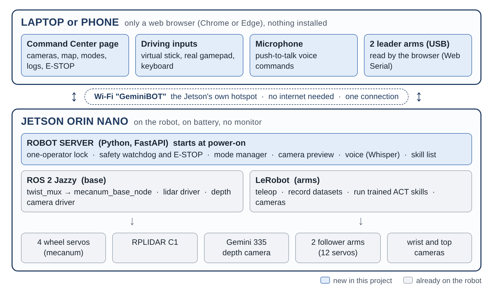

# Architecture



## Parts

| Part | File | Job |
|---|---|---|
| Page | `web/app.js` | Reads gamepad, on-screen sticks and keyboard. Picks one. Sends it 20 times per second |
| Server | `robot_server/main.py` | Serves the page and one WebSocket at `/ws` |
| Controller | `robot_server/control.py` | Operator lock, PIN, E-STOP, watchdog, speed limits. No network or ROS inside, so it is easy to test |
| Base | `robot_server/base.py` | `MockBase` (pretend robot) or `RosBase` (real robot through ROS 2) |

## From stick to wheel

```
stick / gamepad / keys
   -> browser, 20 messages per second
   -> WebSocket /ws
   -> Controller: is this the operator? is E-STOP off? is the message fresh?
   -> /cmd_vel_web                      (ROS 2 topic)
   -> twist_mux                         (robot gamepad on /cmd_vel_joy wins; /e_stop blocks all)
   -> /cmd_vel
   -> mecanum_base_node                 (existing: mecanum math, writes servo speeds)
   -> 4 wheel servos
```

The server sends speeds only while the operator is active. When driving ends it sends a few zeros and then goes silent, so the gamepad on the robot can take over.

## Messages on the WebSocket

All messages are JSON with a field `t`.

**Page to server**

| `t` | Fields | Meaning |
|---|---|---|
| `drive` | `x`, `y`, `z` (-1 to 1), `en`, `turbo`, `src` | Speed wish. `en` = dead-man held. Also the heartbeat |
| `take` | `pin`, `force` | Become the operator |
| `release` | | Give up control |
| `estop` | `on` | Anyone may send `true`. Only the operator may send `false` |
| `ping` | `ts` | Measures the link delay |

**Server to page**

| `t` | Fields | Meaning |
|---|---|---|
| `state` | `you`, `operator`, `estop`, `link_ok`, `need_neutral`, `src`, `cmd`, `odom`, `backend`, `clients` | Sent 10 times per second |
| `note` | `ok`, `msg` | Answer to `take` and `estop` |
| `pong` | `ts` | Answer to `ping` |

Axes: `x` forward, `y` left, `z` turning left. The same directions ROS uses.

## ROS 2 topics

| Topic | Type | Who publishes |
|---|---|---|
| `/cmd_vel_web` | `geometry_msgs/Twist` | Robot server |
| `/cmd_vel_joy` | `geometry_msgs/Twist` | Gamepad plugged into the robot (optional) |
| `/e_stop` | `std_msgs/Bool` | Robot server, 5 times per second |
| `/cmd_vel` | `geometry_msgs/Twist` | `twist_mux` |
| `/odom` | `nav_msgs/Odometry` | `mecanum_base_node`, read by the server for the map |

## What comes next

Camera preview, arm buttons (fold, hold, release), teleop on/off and a run-skill button are added as new modules in `robot_server/` that start and stop the existing programs on the Jetson. See the to-do list in this folder.
