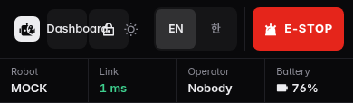

# Dashboard audit

25 November 2026. Proposal only. Nothing on the page was changed.

The dashboard (`web/dashboard.html`) is the second screen: a signed-in person watches the robot, and can press E-STOP. The sticks, arms, skills, and voice stay on the control page. Studio keeps recording and the engineer tools.

The page has grown past that job. The pictures and the system check are what an operator looks at. Under them sit 10 numbers, 9 charts, and four more cards. Most of those repeat something already on screen, or they describe the Jetson computer rather than the robot. On a phone the header itself is the problem: **MOCK** is cut down to **MO…** and the operator name is cut down to **Nob…**, so that Uptime and Devices can fit.

## How this was looked at

Mock mode, signed in, dark theme, pretend cameras from `tests/fake_so101`.

| Shot | File | What it is |
|---|---|---|
| Desktop | [docs/audit/dashboard-desktop.png](audit/dashboard-desktop.png) | Dashboard, 1440 px wide, full page (about 2570 px tall) |
| Phone | [docs/audit/dashboard-phone.png](audit/dashboard-phone.png) | Dashboard, 390 px wide, full page (about 5270 px tall) |
| Control header, desktop | [docs/audit/control-header-desktop.png](audit/control-header-desktop.png) | The top bar of the control page |
| Control header, phone | [docs/audit/control-header-phone.png](audit/control-header-phone.png) | The same bar at 390 px |

The left-hand picture says "Not connected" because that pretend camera list marks the left wrist as unplugged. On the robot that camera is a real one. Wheels and both arms say "Not connected" because mock mode does not read servo boards. On the robot those rows show voltage and temperature. The battery **76%** is a fixed sample. Power, GPU, temperature, and Wi-Fi charts are empty on this computer because those sensors live on the Jetson. The verdicts below are about whether an operator should see the item. They stay the same when the Jetson fills the charts in.

Words used in the table:

| Verdict | Meaning |
|---|---|
| **KEEP** | Needed at a glance while driving, teaching, or watching |
| **MOVE** | Useful, and it belongs on System, Studio, the Voice tab, or a closed "Details" fold |
| **REMOVE** | No decision comes from it, it repeats something else, or it is a placeholder |

## The control page header

The control page (`web/index.html`) uses the same top bar, with two fewer cells.

| Cell | Control page | Dashboard |
|---|---|---|
| Robot | MOCK or ROBOT | Same |
| Link | Round-trip time in milliseconds. Green under 150 ms | Same number, and a second copy in the number grid |
| Operator | "Nobody", "You are driving", or "{name} is driving" | The raw device name only ("Nobody", or whatever the browser called itself). It never says "You are driving" |
| Uptime | Not in the header | Dashboard only |
| Devices | Not in the header. The footer says "v0.7.0 · 1 device" | A header cell, and the footer drops the device count |
| Battery | Same icon. 76% in mock, "Unknown" on the robot | Same icon, plus a whole Battery card further down |

Both pages have the theme button, English / Korean, Studio (lock), and E-STOP. The control page links to the dashboard. The dashboard links back to Control.

On a phone (under 480 px) the word HAEBOT is hidden and only the robot icon remains. Under 560 px the second link keeps its icon and loses its word, so Studio becomes a lock with no label. The status cells wrap onto a second row. The control page has four cells there, so Robot, Link, Operator, and Battery still read clearly. The dashboard adds Uptime and Devices, six cells in the same strip, and **MOCK** and the operator name are cut off with an ellipsis.

The yellow banner under the bar is shared. It stays hidden while the link is up and E-STOP is clear. It shows when the page loses the server, when E-STOP is on (who pressed it, and that a viewer cannot release it), and while the arms fold home after a stop.

## What is on the dashboard

Every row is one thing a person can see. "Where it comes from" is the code path, not a guess.

### Top bar, banner, sign-in, footer

| Element | What it shows | Where it comes from | When it is needed | Verdict | Why |
|---|---|---|---|---|---|
| HAEBOT mark | Name and robot icon | Fixed text | Always, as a wayfinding mark | KEEP | Tells you which page this is. On a phone the word is hidden, the icon stays |
| Robot | MOCK or ROBOT | Server state, `backend` on the 10 Hz `state` message | Every glance | KEEP | The difference between the pretend robot and the real one. On a phone the value is cut to "MO…" |
| Link | "1 ms", "Connecting", or "Offline" | This browser's WebSocket ping, once a second. Green under 150 ms | Every glance, especially on the hotspot | KEEP | The only measure of the link. 1 ms in the screenshots is this computer talking to itself. On the robot it is the phone's round trip |
| Operator | "Nobody", or the driver's device name | `state.operator.name` | Every glance | KEEP | Someone must be able to see who holds the sticks. The wording is poorer than the control page, and on a phone the name is cut off |
| Uptime | "2 min", "1 h 4 min" | Seconds since this server process started | Almost never while driving or teaching | REMOVE | A restart clock does not change a drive, a lesson, or a watch |
| Devices | How many browsers are connected | `state.clients` | Almost never | REMOVE | A count with no names. The operator cell already says who is driving. The control page footer already has the count |
| Battery icon | 76% in the screenshot, with a full battery glyph | `robot.battery()`. Mock always returns 76, not charging, health good. The real robot returns percent null, source "none", so the icon says Unknown | Every glance, once a real pack is wired | KEEP | Charge is a stop-work fact. The slot stays. The number in the screenshot is a sample, and the header looks like a real charge |
| Control | Link to the driving page | Fixed link | Whenever you go back to the sticks | KEEP | The way off this page |
| Studio | Link, lock icon | Fixed link | When teaching or when an engineer opens the tools | KEEP | On a phone the word Studio is hidden and only the lock shows |
| Theme | Sun / moon | This browser | When the room is bright or dark | KEEP | Page chrome, not a robot fact |
| EN / 한 | Language | This browser, both languages already exist | When the operator switches | KEEP | Required on every page |
| E-STOP | Red button. Label becomes STOPPED, and the banner appears | `state.estop`. Escape also sends stop. A press always sends "on" | Every glance, and in an emergency | KEEP | Must stay large. Releasing the latch does not work on this page: the page tells the shared button code that the viewer is never the operator, so "Hold to release" never shows. Release stays on the control page, and only for the person who holds control |
| Banner | Hidden in the screenshots | Offline, E-STOP, or arms folding home | Only in those moments | KEEP | The right place for a full-width warning |
| Sign-in card | PIN form, hidden after login | `/api/login` | Once per browser | KEEP | The gate. Health, the event list, and the server log are withheld until sign-in |
| Footer | "HAEBOT Robot v0.7.0" | `state.version` | When someone asks which build is running | REMOVE | The system-check server row already shows the version |

### Live view

Open by default. The choice is remembered on this browser. Closed, the camera streams stop, and the summary line says how many cameras are connected.

On a desktop the pictures take the left half and the server log takes the right half, so the cameras are the small squares in the screenshot. On a phone the log sits under the pictures (320 px tall) and the system check starts only after that.

| Element | What it shows | Where it comes from | When it is needed | Verdict | Why |
|---|---|---|---|---|---|
| "Live view" summary | Title, and a camera count when the fold is closed | Camera list on the 1 Hz `robot` message | Whenever you open or close the pictures | KEEP | The pictures are the reason this page exists |
| Main camera | Live picture, or "Not connected" / "In use" / "Camera busy" | MJPEG `/camera/top.mjpg` when the camera is present and free. Mock draws a test picture | Driving and watching, the whole time | KEEP | What is in front of the robot |
| Pause cameras | Pauses or resumes all three streams | This browser only. It drops the MJPEG so the hotspot is not carrying video | When the link is weak, or you want the log without video | KEEP | A real control, next to the pictures |
| Lidar | Map, 1 m rings, robot, trail, nearest point | Scan messages, 5 Hz. Mock ray-casts a pretend room and labels it "simulated lidar". The robot sends the live scan | Driving and watching | KEEP | Obstacles, in one picture. On a phone the "simulated lidar" / "lidar" label is hidden |
| Left hand | Picture or "Not connected" | Same path as the main camera, key `left_wrist` | Teaching and close work | KEEP | The empty box in the screenshot is the pretend list. The box itself stays |
| Right hand | Picture or a reason | Key `right_wrist` | Teaching and close work | KEEP | The other gripper |
| Server log | Lines the server prints, newest at the bottom, repeats collapsed to "×12". "live" when the socket is up | WebSocket `log` messages, signed-in pages only. The last 400 lines stay in the browser | When a program fails and someone needs the reason | MOVE | Real, and useful then. It currently takes half of the first screen, in front of the ready check. It belongs in the closed Details fold |
| Window dots, "haebot@jetson ~ %", blinking cursor | Decoration. Nothing can be typed | Fixed markup | Never | REMOVE | It looks like a shell. The dots turn red, yellow, and green on hover, and red on this product is for E-STOP |

### System check

Thirteen rows, built in the browser from the robot message. Green is fine, amber is "do this", grey is "not connected and not required right now". The badge in the screenshot says **4 need attention** (wheels, both arms, left camera). That count is the mock machine. On the robot it follows the real boards and cameras.

The web page's obstacle stop is what the lidar row calls "obstacle stop on". That switch defaults to on. The robot's own lidar guard in `~/so101` is a different switch, and it stays off until the Studio lidar setup is saved. The Drive tab on the control page is the place that shows both. This row shows the web one.

| Element | What it shows | Where it comes from | When it is needed | Verdict | Why |
|---|---|---|---|---|---|
| "N need attention" / "All good" | One badge for the whole grid | Count of amber rows | Every glance | KEEP | This is the ready light. It still makes you read the grid to learn which part failed |
| Robot server | "Pretend robot · v0.7.0 · 2 min", or "No connection" | Socket open, backend, version, uptime | When the page is offline, or someone needs the version | MOVE | The header already says MOCK or ROBOT. The version can live in Details |
| Wheels | Connected, voltage, "base ready / starting", or "not connected" plus what to check | Servo probe of the wheel board, and the base job. Amber under 11 V, or if the base is running and the wheels do not answer | Before any drive, and when a drive will not start | KEEP | A wheel that is dead is a stop-work fact. Show the row when it is amber. A healthy row can sit in Details |
| Right arm (black) | Motors answering, lowest voltage, hottest joint, or USB / 5 V / alarm / over 55 °C | Servo probe, about every 6 seconds. Skipped while a program holds that port. Mock does not probe, so the row stays "not connected" | Before teaching or a skill, and when a motor alarms | KEEP | Same rule as the wheels: the amber row stays in the glance |
| Left arm (green) | Same, plus a warning if the arm answers but the server was started without the left arm unlocked | Same probe, and `left_arm_ok` | Same as the right arm | KEEP | The green arm is easy to leave locked out after a calibration |
| Right leader | Connected, or grey "only needed to steer by hand" | Same probe. A missing leader is grey, not amber | While setting up teleop | MOVE | Optional. A grey row on every watch adds length and is not a fault |
| Left leader | Same | Same | Same | MOVE | Same reason |
| Main camera | Streaming, ready, in use, busy, or unplugged | Camera list. "In use" is green, because a skill or a recording is allowed to take it | Before driving or a skill that needs the top view | KEEP | Amber when it is missing or another program holds it by mistake |
| Right hand | Same | Camera list | Before a right-arm skill or a recording | KEEP | Same |
| Left hand | Same | Camera list | Before a left-arm or two-arm lesson | KEEP | Same. The amber row in the screenshot is the pretend list |
| Lidar | Scanning or simulated, and whether the web obstacle stop is on. Amber if the stop is off, the lidar is missing, or it is plugged in and not scanning | Latest scan (less than 2 s old), `/dev/rplidar`, and the web guard flag | Every drive | KEEP | "Stop is off" and "no scan" are drive facts. The row does not say "holding, obstacle in front". The Drive tab does |
| Gamepad | Connected, or grey "optional" | `/dev/input/js0` on the Jetson | When someone expected the robot's gamepad | MOVE | Keyboard and on-screen sticks cover driving. Grey is not a fault |
| Microphone | USB mic present, or grey "voice needs one" | The server's sound-card check | When voice is about to be used | MOVE | The Voice tab already says if the mic is missing |
| Jetson | CPU °C, memory %, free disk. Amber at 85 °C, 92% memory, or under 2 GB free | `/proc` and thermal zones on the computer running the server. This PC had no temperature zone, so the screenshot shows "CPU - °C · memory 70% · 264.1 GB free" | When the computer is in trouble | MOVE | A calm memory percentage is an engineer fact. The amber case belongs on the ready line |

### The ten numbers

One card, five columns on a desktop and two on a phone. A dash means that sample has never arrived since the page was opened. Charts keep the same samples for five minutes, in this browser only. A refresh clears them.

| Element | What it shows | Where it comes from | When it is needed | Verdict | Why |
|---|---|---|---|---|---|
| Speed | 0.00 m/s in the screenshot, "last 5 min" | Odometry speed if a pose exists, otherwise the commanded speed. Sampled twice a second | While driving | KEEP | One number is the glance. The chart under it repeats it |
| Distance driven | 0.0 m, "since the server started" | Odometry, added up in the server, reset when the server starts, jumps over 0.5 m ignored | Rarely | REMOVE | It is not the length of this move. It resets on a restart |
| Nearest object | 1.17 m, "on the right" in the screenshot | Nearest lidar point in the browser, from the latest scan. "no lidar" when the scan is older than 1 s | While driving | KEEP | Direction and distance in one look. The lidar picture shows the shape. The bar chart below repeats the four sides |
| Power | "- W", or watts, with CPU+GPU and SoC underneath | Jetson INA3221 power sensors. This PC has none, so it stays a dash. Mock does not invent a number | When chasing a power fault on the Jetson | MOVE | This is the computer's draw, not the robot battery |
| CPU load | 8% and "4 cores" in the later screenshot | `/proc/stat` on the computer running the server, about every 3 s | When the Jetson is overloaded | MOVE | The system check already warns on temperature and memory. The percentage belongs in Details |
| GPU load | "- %" and the caption "Orin Nano" | Jetson GPU load files. Absent on a normal PC, so the value stays a dash. The caption is fixed text | When a skill is heavy on the GPU | MOVE | The caption says Orin Nano even on a laptop, where the value never arrives |
| Jetson temperature | "- °C", or CPU °C and GPU °C | Thermal zones. None on this PC | When the computer is hot | MOVE | The system-check Jetson row already has the temperature, and it warns at 85 °C |
| Memory used | 70%, "11.0 / 15.6 GB" | `/proc/meminfo` | When memory is tight | MOVE | Same row already shows the percentage and warns at 92% |
| Wi-Fi | "- KB/s", or down and up | Bytes on a `wl` or `wlan` interface, between two health reads. This PC has no such interface | Almost never for an operator | REMOVE | Kilobytes per second is not "can the phone still drive". Link milliseconds answer that |
| Link | The same milliseconds as the header, "this device" | The same ping | Every glance, once | REMOVE | The header already shows it |

### The nine charts

Each one is a card about 160 px tall. "No data yet" is honest: the page does not draw a fake line. "No servo answering" is the empty servo charts.

| Element | What it shows | Where it comes from | When it is needed | Verdict | Why |
|---|---|---|---|---|---|
| CPU and GPU | Two lines, last five minutes, 0–100% | The CPU and GPU samples above. GPU stays absent off the Jetson, so the screenshot is a CPU line only | When a skill is melting the computer | MOVE | Engineer trend. Details, not the first screen |
| CPU per core | One bar per core | `cpu_cores` from the same `/proc` read | Almost never | REMOVE | Four bars do not change a drive or a lesson. One CPU number is enough |
| Temperatures | CPU, GPU, and average SoC, °C | Thermal zones whose names start with `cpu`, `gpu`, or `soc` | During a long skill or a long recording | MOVE | Worth having when the Jetson heats up. Not next to the cameras |
| Power | Total, CPU+GPU, SoC, watts | The same INA3221 rails | When chasing a Jetson power fault | MOVE | With the power number, in Details |
| Robot speed | Speed line, suggested top 0.3 m/s | The speed sample | While driving, the number is enough | REMOVE | A five-minute trace of a speed you can already see is a second copy |
| Wi-Fi traffic | Received and sent, KB/s | The same interface counters | Almost never | REMOVE | Same as the Wi-Fi number. It is volume, not link quality |
| Nearest object by side | Horizontal bars, front / left / right / back, metres | The same scan, split at 45° and 135° | While driving, as four numbers | MOVE | The four distances are worth one line under the lidar. The bar chart is a second copy of the picture |
| Servo voltage per board | One bar, lowest voltage, per board that answered | Servo probe. Empty in mock, and empty on the robot until a board answers | When a 5 V or 12 V rail sags | REMOVE | The servo table already lists the volts. Two views of one probe |
| Servo temperature per joint | One bar per joint that reported °C. Labels are a letter plus an id | Same probe | When a joint is hot | REMOVE | The system check turns amber at 55 °C and names the board. A row of joint codes is not a glance |

### Bottom cards

Three columns on a wide screen, one column on a phone.

| Element | What it shows | Where it comes from | When it is needed | Verdict | Why |
|---|---|---|---|---|---|
| Battery card | Percent, charging, health, and a note | Same `robot.battery()` as the header. The note says the 76% is a sample. On the robot the note says there is no reading yet | Once, to learn that the pack is not wired | REMOVE | The header icon repeats the percent. Its tooltip already has the sample / not-wired sentence. The card spends a column on that sentence |
| Servo boards | A table: board, voltage, °C, current, alarm. Mock prints "servo boards are not read" | Servo probe. Missing, busy, no-power, and alarm are written out | When a board is silent or hot | MOVE | Real on the robot, and the system check already summarizes each board. The full table belongs in Details |
| Programs | Ten rows, all "not started" in the screenshot: base, teleop right, teleop left, right arm pose, left arm pose, leader, skills, voice, check wizard, recording. A running row shows the time since start. A stopped row can show an exit code | Job table on the robot message, about once a second | While a skill, teleop, voice, or recording is running | MOVE | "Skill running" is a glance. Ten lines of "not started" are not. The check wizard is an engineer job. The table also drops the reason a program died (USB lost, killed, error), which the control page already shows |
| Voice | A large "-" , or the last phrase heard | `robot.voice.text`, signed-in only | While testing voice | REMOVE | The Voice tab already shows the phrase and a log. A dash on the dashboard is empty space |
| Activity | "Nothing yet", or the last 20 events with time, who, and text | `robot.events`, signed-in only | After an incident, to see who pressed what | MOVE | This is the real history. A single "last error" line covers the glance. The list opens in Details |

## What is missing

These are facts an operator needs that this page does not put in one place.

1. **A ready sentence.** "4 need attention" is a count. It does not say "safe to drive" or "not ready: wheels, left camera". The thirteen rows are the parts. The sentence is missing.
2. **E-STOP as a state.** The button is the action. After a press it says STOPPED and the banner explains it. While it is clear, nothing says "E-STOP clear". Releasing the latch is missing on this page entirely.
3. **Link quality beyond one millisecond number.** There is no "video stalled", no lost pings, and no "lidar scans stopped" on this page. The Drive tab already has wheel-odometry hertz and lidar hertz, and the dashboard ignores them. On a phone the millisecond number survives, and the word MOCK does not.
4. **Arm and camera health as a glance, including the failure.** Connection, voltage, heat, and alarm are in the system check, which is good, and they sit below the log. What is missing is the reason a program died (`USB lost`, `killed`, `error`), which the control page already writes under the arms and the skill. Camera frames per second exist for Studio and are not shown here. A frozen picture is only retried in the background.
5. **Battery, for real.** The slot is on the page. The pack is not wired. Mock shows a healthy 76%. The robot shows Unknown. A sample that looks real is worse than an empty slot labeled "not wired".
6. **Skill progress.** The control page shows "run 2 of 5", the pause between runs, and "the model is loading, the arm has not moved yet" for the first 45 seconds. The dashboard only has a Programs row, "running" plus a clock. The repeat counter is already in the robot message. This page does not read it.
7. **The last error, kept on screen.** Activity is empty until something happens, then it is twenty mixed lines. A program can exit and the dashboard shows a code, not the sentence. There is no line that stays as "last error: …".
8. **Obstacle stop, right now.** The lidar row can say the stop is on. It does not say "held, obstacle in front" or "lidar was working and the scans stopped", which is when the robot refuses to move. The Drive tab shows that.

Recording progress (episode count) lives in Studio. A watcher on this page only sees "Recording (Studio) running". That is the same gap as skill progress, for teaching.

## A tighter page

Seven items on a desktop, top to bottom. The first screen answers "is it safe, what do I see, what is it doing". Everything else is one closed fold.

1. **Header.** Robot mode (MOCK or ROBOT, never cut off), link milliseconds, who is driving in the control page's words, battery (real percent, or the words "not wired"), E-STOP. Theme, language, Control, and Studio stay. Uptime and Devices leave the header.
2. **Ready line.** One sentence. "Ready", or "Not ready: wheels, left camera". Under it, only the amber rows, each with the "what to do" line it already has. E-STOP clear or latched. Obstacle stop on, off, or holding, including "scans stopped".
3. **Pictures.** Main camera large, lidar beside it, both hands smaller. Pause cameras stays. The server log does not sit beside them.
4. **Driving line.** Speed, nearest object (direction and distance), and the four side distances as text under the lidar rather than a chart.
5. **What it is doing.** One line: idle, or "teleop right, 2 min", "skill run 2 of 5, loading", "voice on", "recording". The full idle roster goes away.
6. **Last error.** One line. "None", or the latest program failure or E-STOP, with the time. The event list stays in the fold.
7. **Details, closed.** System-check rows that are healthy or optional, servo table, Jetson (CPU, temperature, memory, disk, and the power and temperature charts), server log, activity. Open it when something is wrong.

Phone, 390 px, same order, fewer words in the header so nothing is cut off:

1. **Header.** Robot icon, link, battery, E-STOP, Control, Studio's lock, language. Robot mode and the driver move into the ready line, where the full words fit.
2. **Ready line.** The sentence, then only the amber rows. This is above the pictures, so a phone does not scroll through the log to learn the robot is not ready.
3. **Main camera.** Full width. Pause stays on the picture.
4. **Lidar and both hands.** Lidar keeps its "live" or "simulated" label, which the phone currently hides.
5. **Now.** Speed, nearest object, what it is doing, last error. One card.
6. **Details.** Closed. Same contents as the desktop fold.

Left off both layouts, on purpose: uptime, device count, distance since launch, Wi-Fi kilobytes, per-core bars, the speed chart, both servo charts, the battery card, the voice dash, the fake terminal prompt, and the ten "not started" program rows.

## What was not decided

This file is the audit. The page is unchanged. Building the tighter layout waits for a yes.
